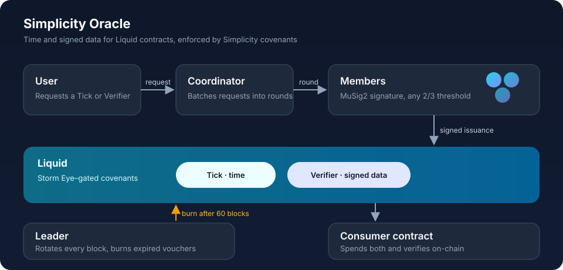

# Simplicity Oracle

A federated oracle network for [Liquid](https://liquid.net), enforced by
[Simplicity](https://github.com/BlockstreamResearch/simplicity) covenants.

Smart contracts can't see the outside world. Simplicity Oracle gives them two
things they can check on-chain: the current time, and data signed by an
independent federation. No single operator is trusted. Every attestation needs a
threshold signature from the network, and every network action is enforced by a
covenant.

## What it provides

- **Time.** A *Tick* is a network-issued UTXO whose amount is a timestamp. A
  contract that spends a Tick learns, inside its own script, when the network
  vouched for it.
- **Signed data.** An *Oracle Verifier* is a UTXO committed to the network's
  signing key. A contract that spends one can check any message signed by that
  key. Price feeds are the first data type; the signature scheme itself works for
  any data.
- **Freshness.** Ticks and Verifiers expire after 60 blocks and the network burns
  them, so old attestations stop being usable on-chain.
- **Spending rules for vouchers.** Each voucher is locked to its requester by a
  public key, a script or an asset. Only the requester, or the network when
  burning it, can spend it.

## How it works



- **Network.** Members communicate over Storm, an authenticated, Noise-encrypted
  peer-to-peer layer. Any two-thirds of members can sign jointly with MuSig2.
  Every such subset is committed to in a Merkle tree, the *Storm Tree*.
- **Authorization.** A single on-chain asset, the *Storm Eye*, gates every
  network action. Treasury, Account and Voucher covenants accept a spend only
  when a Storm Eye input is present.
- **Roles.** A coordinator batches user requests into issuance rounds. A leader,
  rotating every block, burns expired vouchers.
- **Governance.** Membership changes and Storm Eye maintenance go through
  on-chain votes. Operators earn *Droplets*, rewards they can exchange for L-BTC
  held in the network's treasury.

## Using it in a contract

The consumer SDK, [`voucher_verifier.simf`](contracts/simf/sdk/voucher_verifier.simf),
provides the checks a Simplicity contract needs:

| Function | Checks |
| --- | --- |
| `verify_tick` | A Tick input is genuine; returns its time |
| `verify_verifier_utxo` | A Verifier input is committed to the expected signer |
| `verify_price` | A signed price is authentic and valid at a given time |
| `verify_tick_with_price` | All of the above in one call |

## Repository

| Path | Description |
| --- | --- |
| [`high-storm`](high-storm) | Oracle node: chain indexing, issuance, burning, voting and the external API |
| [`storm`](storm) | Peer-to-peer messaging |
| [`storm-tree`](storm-tree) | MuSig2 threshold-key Merkle tree |
| [`storm-operator`](storm-operator) | CLI for managing node operators |
| [`contracts`](contracts) | Simplicity covenants and the consumer SDK |
| [`price-feed`](price-feed) | Feed registry, sources and aggregation |
| [`web/sdk`](web/sdk) | TypeScript client SDK |
| [`web/operator`](web/operator) | Operator console |
| [`specs`](specs) | Protocol and contract specifications |

## Quick start

Run a local three-node network with Elements and PostgreSQL. This requires Docker.

```sh
high-storm/devenv.sh create   # build and start a fresh network
high-storm/devenv.sh up       # restart, keeping state
high-storm/devenv.sh down     # stop
```

See [`high-storm/README.md`](high-storm/README.md) for configuration, network
initialization and the external API.

## Development

Requires Rust 1.97.1, which [`rust-toolchain.toml`](rust-toolchain.toml) pins.

```sh
cargo build --workspace
cargo test --workspace --exclude contracts
cargo clippy --workspace --all-targets -- -D warnings
```

Contract tests run under the Simplex regtest harness; see
[`.github/workflows/contracts-tests.yml`](.github/workflows/contracts-tests.yml).

## Documentation

- [Network architecture](specs/oracle-network-architecture.md): topology, roles,
  messaging, signing, assets and security model.
- [Contracts specification](specs/contracts-specification.md): Storm Eye, Treasury,
  Voucher and Account covenants.

## License

[MIT](LICENSE) © 2026 Blockstream Research
